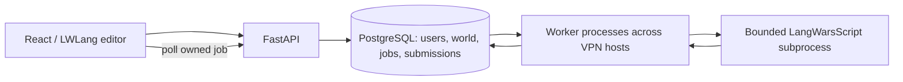

# Shared world and judging

The browser sends source code to the API, which authenticates the user, applies admission rules, and creates a durable run or submit job. A worker claims one job at a time. The interpreter receives a consistent world snapshot and administrator/task policy. Its result is data, not executable host code.

Every test starts from the same world snapshot. Published values are serialized by value, so references within one execution cannot leak between jobs. Hidden test inputs and expected outputs stay on the server. Runs never publish. Failed submissions never publish.

Publication uses the first test's resulting state after all tests pass. Parameter bindings are global within execution but do not publish on their own; explicit declarations, assignments, and observable mutations do. This keeps harness-supplied arguments out of the shared namespace. The interpreter notes explain this choice where the spec leaves the publication boundary unclear.

Publication must atomically validate the world version, current administrator policy, account eligibility and name budget, and applicable operation contracts before writing the new world, submission verdict, and completion result. A worker whose snapshot became stale retries against the current world instead of blindly committing an old contract check. Jobs use lease ownership to prevent a replaced worker from committing a duplicate result.

Changing shared names queues read-only rechecks of affected accepted submissions. Rechecks substitute definitions published after the original submission and ignore writes to those substituted names. Global operation changes can affect indirect dependencies, so they require conservative invalidation. Rechecking must not republish old values or award duplicate points.

The implementation uses spec terminology in server packages and LWLang in the interface. Optional floats and the explicitly excluded experimental external-data operations are not implemented. See [interpreter decisions](../server/langwarsscript/DECISIONS.md) for precise semantics in underspecified cases, including evaluation order, control transfers, collection cycles, and finite contract checking.
